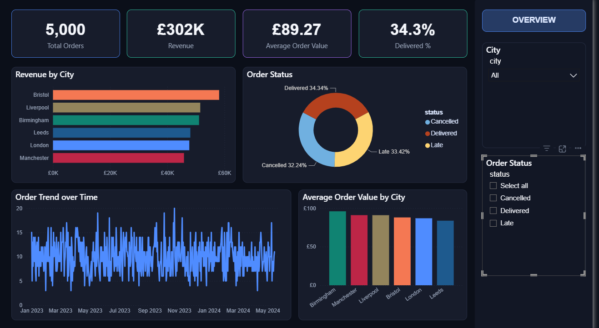

# 🍔 Food Delivery Analytics System

An end-to-end data analytics project exploring food delivery operations, revenue performance, order status, and city-level trends using Python, PostgreSQL, SQL, and Power BI.

## 📌 Overview

This project turns raw food delivery data into business insights through data cleaning, relational data analysis, and an interactive Power BI dashboard.

The dashboard highlights:
- Overall order volume and revenue
- Average order value
- Order status distribution
- Revenue by city
- Order trends over time
- Average order value by city

## 🛠️ Tech Stack

- **Python:** Pandas for data cleaning and preprocessing
- **Database:** PostgreSQL
- **Query Language:** SQL
- **Visualization:** Microsoft Power BI

## 🔄 Workflow

1. Explored and cleaned the raw dataset using Python and Pandas.
2. Designed and managed relational data in PostgreSQL.
3. Analyzed the data using SQL queries, JOINs, and aggregations.
4. Built an interactive dashboard in Power BI.
5. Reviewed revenue, order status, and city-level performance.

## 📊 Final Dashboard

The Power BI dashboard summarizes food delivery performance across key business metrics and city-level comparisons.

### Dashboard KPIs

| Metric | Dashboard value |
|---|---:|
| Total Orders | 5,000 |
| Revenue | £302K |
| Average Order Value | £89.27 |
| Delivered | 34.3% |

### Key Observations

- Bristol shows the highest revenue among the cities displayed.
- The order-status chart shows a relatively balanced split between Cancelled (32.24%), Delivered (34.34%), and Late (33.42%).
- Average order value varies across the cities shown in the dashboard.
- The order trend visual covers January 2023 to May 2024.

*Values above are transcribed from the dashboard preview.*

## 📁 Project Assets

- **Power BI dashboard file:** [Food_Delivery_Dashboard.pbix](dashboard/Food_Delivery_Dashboard.pbix)
- **Dashboard screenshot:** [Final_Dashboard.png](dashboard/Final_Dashboard.png)

## 🚀 Skills Demonstrated

- Data Cleaning and Transformation
- Python (Pandas)
- PostgreSQL and SQL
- SQL JOINs and Aggregations
- Data Visualization
- Power BI Dashboard Development
- Business Intelligence and Insight Generation

## 👨‍💻 Author

**Pratham Sinha**

[GitHub Profile](https://github.com/PrathamSinha07)
